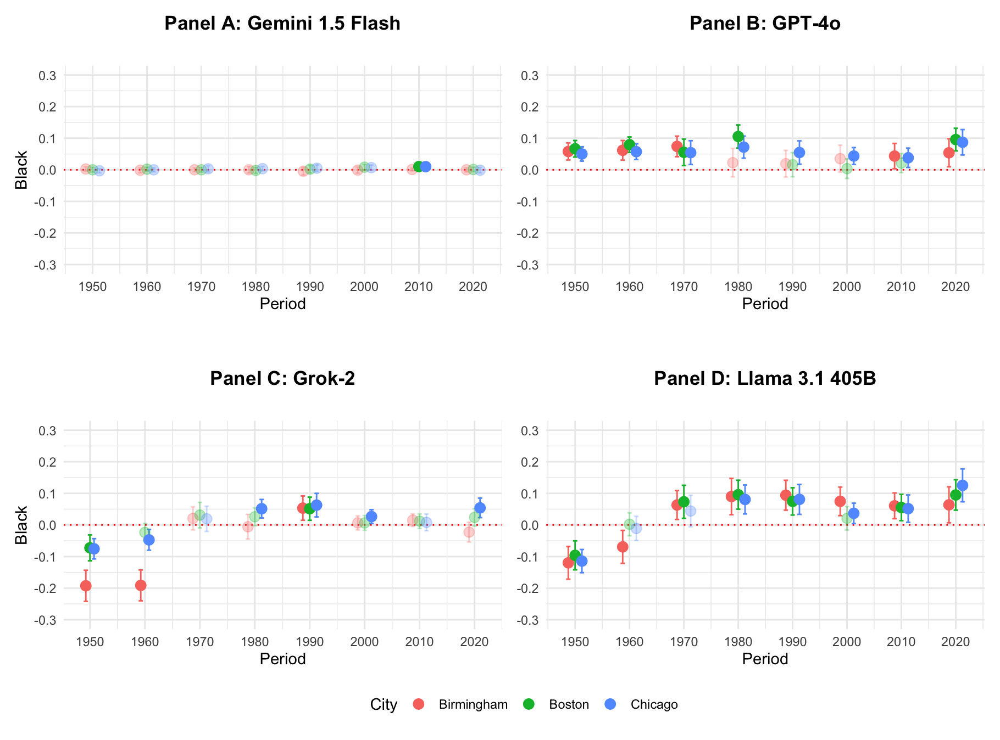

# LLM AuditKit

Build controlled hiring experiments to study how large language models make
decisions. Generate resume templates, set applicant attributes, run simulations,
and analyze the results—scaling from a few examples to thousands of simulated
hiring decisions.

[Explore the interactive walkthrough](https://kirillutyashev.github.io/LLM_AuditKit/)

## Example analysis

[](website/assets/paper-role-play-coefficients.png)

Example from our earlier hiring-audit paper: estimated differences in interview
callback probability between applicants assigned Black- and White-sounding names
under role-play prompts.
This is a research example, not an analysis of the walkthrough's small demo.
[Figure provenance](website/assets/README.md#paper-coefficient-plot).

## What you can do

- **Prepare data:** load and validate job datasets, optionally extracting ads
  from newspaper scans with OCR first.
- **Design controlled applications:** generate multiple resume templates per job
  and fill names, addresses, education, dates, and other fields using your own
  assignments or reproducible sampling pools.
- **Run experiments:** configure models, prompts, and personas in YAML; use sync
  or async inference with batching and resumable CSV checkpoints.
- **Analyze decisions:** retain decisions, comments, and requested log
  probabilities; prepare data and estimate, export, and plot regressions in R.

## Quickstart

Use **Python 3.10+**. From a terminal on macOS or Linux:

```bash
git clone https://github.com/KirillUtyashev/LLM_AuditKit.git
cd LLM_AuditKit
python3 -m venv .venv
source .venv/bin/activate
python -m pip install -e .
python examples/template_population/preview.py
```

This offline example fills two synthetic job scenarios and prints the applicant
IDs and experiment prompts. No API key, paid model calls, or R installation is
needed.

For your first model call, follow the
[shared-inference guide](docs/guides/shared_inference.md#configure-openai-credentials).
Keep credentials in your local `.env`, never in Git or YAML. Live model calls
incur provider charges; OCR and regression have additional setup requirements.

## Run your own audit

Start with the [YAML pipeline guide](docs/guides/pipeline.md) to connect stages,
or use them individually:

- [Dataset loading](docs/guides/dataset_loading.md) and optional
  [newspaper OCR](docs/guides/newspaper_ocr.md).
- [Resume template generation](docs/guides/template_generation.md).
- [Template population and candidate sampling](docs/guides/template_population.md).
- [Experiment execution](docs/guides/experiment_execution.md).
- [Regression preparation, estimation, and plotting](examples/regression/README.md).

The Python stages pass DataFrames between stages and save CSV checkpoints.
Regression uses a separate, locked R environment. Inspect prepared data and set
your research specification before running estimation; the continuous pipeline
does not automatically run regressions.

## Contributing

See [AGENTS.md](AGENTS.md) for setup and test commands,
the [architecture](docs/architecture.md) for component contracts, and the
[development workflow](docs/development_workflow.md) for branches, reviews,
and pull requests.
